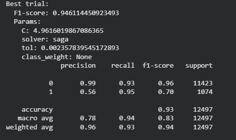
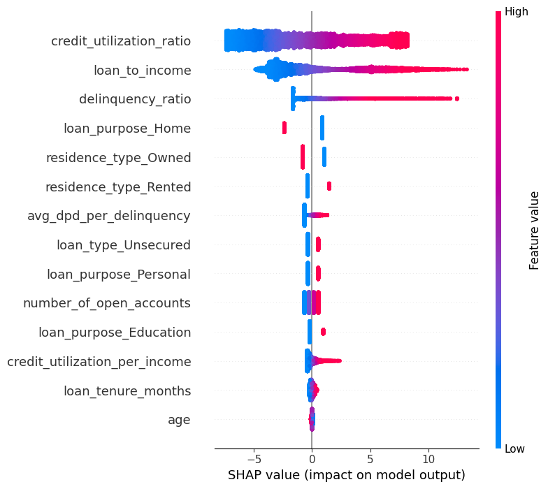
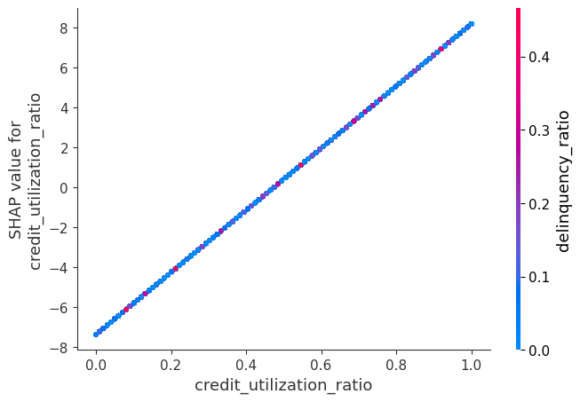
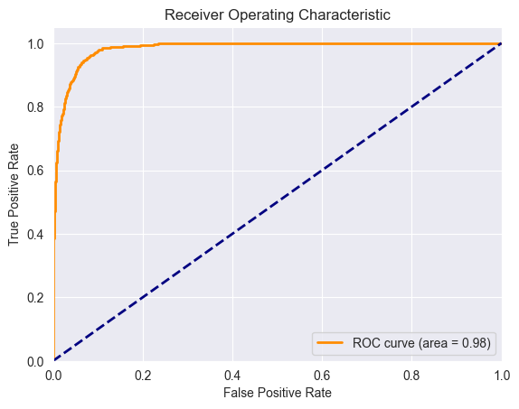
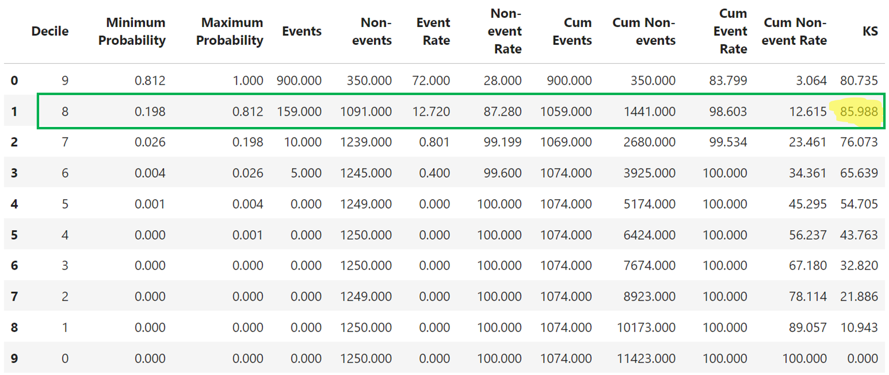
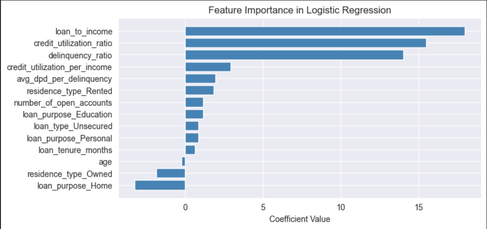
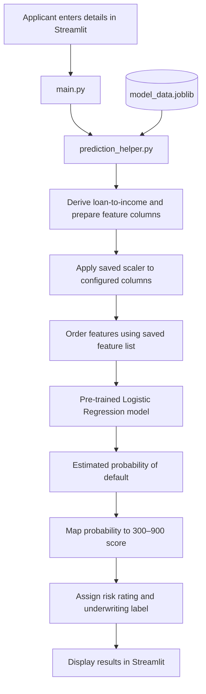

# Kapex Finance AI Credit Risk Modelling App

A Streamlit application for exploring loan-applicant details and estimating credit default risk. The app loads Logistic Regression model which is trained on Bureau data and its preprocessing artifacts, then returns an estimated probability of default, a credit score on a 300–900 scale, and a risk rating.

Live Link: https://kapex-finance.streamlit.app/

## Table of Contents

- [Business Objective](#business-objective)
- [Application Overview](#application-overview)
- [Scoring Workflow](#scoring-workflow)
- [Credit Score and Risk Ratings](#credit-score-and-risk-ratings)
- [Model Artifacts and Explainability](#model-artifacts-and-explainability)
- [Repository Structure](#repository-structure)
- [Run Locally](#run-locally)
- [Current Limitations](#current-limitations)

## Business Objective

Credit risk assessment helps lenders evaluate the likelihood that a loan applicant may default. This application provides an interactive way to review applicant and credit-history information and translate a model prediction into a score and risk category.

The app is designed to help users:
- Review key applicant, loan, and credit-history characteristics.
- Inspect derived indicators before requesting a prediction.
- View estimated default probability alongside a 300–900 score and risk rating.
- Use the rating as a decision-support signal for further underwriting review.

The score and rating are outputs of this application, not a guarantee of repayment or a substitute for a lender's full underwriting policy.

## Application Overview

The interface is organized into three input sections:

- **Profile & Capital:** age, annual gross income, loan amount, and loan tenure.
- **Credit Velocity:** credit utilization, delinquency ratio, average days past due, and number of open accounts.
- **Loan Structure:** residence type, loan type, and loan purpose.

Before scoring, the UI displays the loan-to-income ratio, estimated principal per month, and credit utilization. Selecting **Calculate Risk** runs the prediction pipeline and displays the default probability, score gauge, and rating.

### Model Stats

**Logistic Regression Model — Classification report**



**SHAP Plot**


**SHAP Summary**
1. credit_utilization_ratio: High values (red) increase the likelihood of default, as shown by positive SHAP values.
2. delinquency_ratio: Similarly, higher values increase the risk, shown by positive SHAP values.
3. loan_to_income: Higher values (red) also increase the default risk.
4. residence_type_Owned and residence_type_Rented: Different impacts based on whether the residence is owned or rented.
5. avg_dpd_per_delinquency: Higher average days past due per delinquency increase the risk.

**SHAP Dependence plot**



**Model Evaluation:**

1. **ROC Curve:**
    


2. **Model trials and performance:** 

    | Models | AUC | Gini |
    | :--- | :---: | :---: |
    | Logistic Regression | 98 | 96 |
    | XGBoost | 99 | 96 |
    | Random Forest | 97 | 95 |

    AUC of 0.98: The model is very good at distinguishing between events and non-events.Gini coefficient of 0.96: This further confirms that the model is highly effective in its predictions, with almost perfect rank ordering capability.The Gini coefficient ranges from -1 to 1, where a value closer to 1 signifies a perfect model, 0 indicates a model with no discriminative power, and -1 signifies a perfectly incorrect model.


3. **KS statistic:**

    

    KS ValueThe highest KS value is 85.88%, found at Decile 8. This indicates that the model's performance in distinguishing between events and non-events is most significant at this decile. (If KS is in top 3 decile and score above 40, it is considered a good predictive model.)

**Feature Coefficient visualization**



## Scoring Workflow

The application follows this prediction flow:



1. `main.py` collects applicant inputs and calls `predict_risk`.
2. `prediction_helper.py` derives loan-to-income, builds the model input columns, applies the saved scaler to configured columns, and orders the data using the saved feature list.
3. The fitted Logistic Regression model calculates the estimated probability of default.
4. The app maps the probability to a credit score and assigns a risk rating.

### Key derived indicators

- **Loan-to-income ratio:** relates the requested loan amount to annual gross income.
- **Delinquency ratio:** represents the proportion of recorded loan months classified as delinquent.
- **Average days past due (DPD):** summarizes the average recorded days past due per delinquency.

These indicators help present applicant repayment and credit-history information in a form the model can use. The exact values supplied to the model depend on the preprocessing logic and saved artifacts.

## Credit Score and Risk Ratings

The app maps the estimated probability of default to a 300–900 score using a linear transformation:


$$\text{Credit Score} = 300 + (1 - P(\text{Default})) \times 600$$


Under this mapping, a lower estimated default probability produces a higher score. This is the application's custom score transformation; it should not be confused with a bureau-issued credit score or a separately calibrated industry scorecard.

| Score range | Risk rating | Application's underwriting label |
| ---: | --- | --- |
| 750–900 | Excellent | Prime tier / auto approve |
| 650–749 | Good | Low risk / standard approval |
| 500–649 | Average | Moderate risk / conditional |
| 300–499 | Poor | High risk / manual review |

These labels are application outputs. Actual lending decisions should also account for the lender's underwriting policy, validation requirements, and applicable regulations.

## Model Artifacts and Explainability

The application expects `app/artifacts/model_data.joblib` to contain the following keys:

- `model`
- `features`
- `scaler`
- `cols_to_scale`

The helper loads the artifact using the relative path `artifacts/model_data.joblib`, so run Streamlit from the `app` directory.

The helper uses the saved model's `coef_` and `intercept_`, so the expected estimator is a fitted linear Logistic Regression model. The coefficient image can help inspect model terms, but coefficients are affected by feature scaling and should not be interpreted as proof of causation.

## Repository Structure

```text
.
├── app/
│   ├── artifacts/
│   │   ├── model_data.joblib     Trained Logistic Regression Model
│   │   ├── img.png               Model coefficients importance chart 
│   │   └── img_2.png             Model Classification report
│   ├── main.py                   Streamlit interface
│   └── prediction_helper.py      Credit Risk Prediction helper
├── data_and_notebooks            Model training Jupyter notebooks and datasets.
├── requirements.txt              List of dependencies
└── README.md                     Project documentation
```

## Run Locally

Ensure Python and the packages listed in `requirements.txt` are installed.

```bash
# From the repository root
cd app
streamlit run main.py
```

Open the local URL printed by Streamlit, usually `http://localhost:8501`.

## Notes

- This is a learning project based on real world simulated data.
- Some inputs in the model feature frame are currently populated with fixed placeholder values in `prepare_data`; they are not collected in the UI.
- The score is a linear transformation of the predicted probability. It is not, by itself, evidence that the probability is calibrated or that the score has been validated for real-world lending decisions.
- Before using the application for actual underwriting, validate the model on appropriate unseen data, review the preprocessing and placeholder inputs, and assess calibration, fairness, stability, and decision thresholds.

## License

This project is open-source and available under the [MIT License](LICENSE).